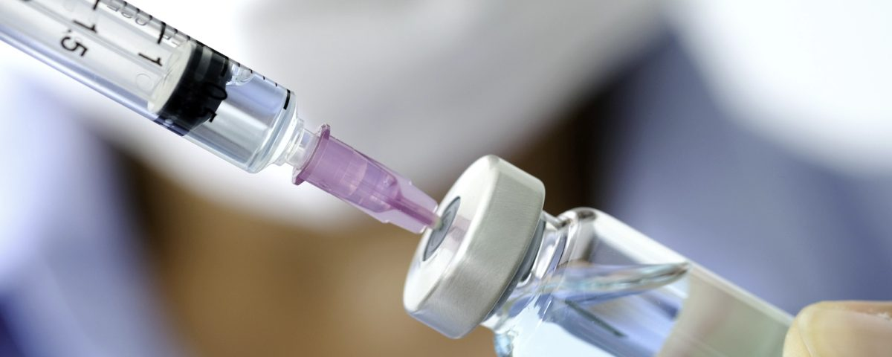

<!-- esasim: cover -->

<!-- /esasim: cover -->

# Virtual patients: drug dosing study

A whole-body **physiologically based pharmacokinetic (PBPK) model** of a drug, run in thousands of virtual patients at once. It answers the questions a dosing study asks:

- **Who does a regimen work for?** The share of patients in the target range, below it, above it, and reaching toxic peaks, overall and by group (smokers, age bands, sex, heart failure, liver cirrhosis, kidney impairment).
- **What dose suits each population?** For every population, the dose that puts the most patients in range while keeping toxic peaks rare.
- **What happens inside one patient?** A patient followed live in 3D, each organ coloured by the drug's concentration in it.

The first drug is **theophylline** (a bronchodilator with a narrow therapeutic window, cleared mainly by the liver's CYP1A2 enzyme, and strongly affected by smoking, age, liver disease and heart failure). That makes it a good teaching example for why one dose does not fit everyone.

> This is a teaching and exploration model, not a validated clinical tool. Do not use it to dose real patients.

## The flows

| Flow | What it does |
|---|---|
| **1 · Virtual trial** | A population on a regimen (dose, interval, route, loading dose, days). Shows the plasma concentration over time (5th to 95th percentile), the spread of steady-state levels, outcomes by group, and a table of every patient. |
| **2 · Find the dose** | Every population at doses from 25 mg to 2 g, with a curve per population of the share in range and the share with toxic peaks, and the best dose for each. |
| **3 · Follow one patient (3D)** | The typical, most exposed, least exposed or a random patient, live. The organs are coloured from dark blue (no drug) through green (in range) to red (toxic). The heart beats and the lungs breathe, and doses and threshold crossings appear as events. |
| **Maintenance · Make the 3D models** | Reads a labelled CT case from the TotalSegmentator dataset and builds the patient from it, with the platform, the heartbeat sound and the scene, into the project's assets (models/). Run it once. |

Each trial takes a few seconds, even for 10,000 patients, on a GPU or a CPU.

## The model

**Compartments (16 states).** Lungs, brain, heart, kidneys, liver, gut (stomach and intestines), spleen, pancreas, fat, bone, muscle, skin and the rest of the body. There is also arterial blood, venous blood and the gut lumen (where an oral dose is absorbed). The gut, spleen and pancreas drain into the liver through the portal vein, so an oral dose passes the liver first.

**Distribution.** Blood-flow limited. Tissue:plasma partition coefficients follow the Rodgers & Rowland method (acids, neutrals and very weak bases), from each tissue's composition: water, neutral lipids, phospholipids and albumin. They are scaled once so that a reference adult's volume of distribution matches the observed one (0.5 L/kg).

**Elimination.** Liver metabolism on the unbound drug (well-stirred liver), plus renal excretion scaled by kidney function (GFR). The hepatic intrinsic clearance is set so that a reference adult non-smoker's total clearance is the observed 0.04 L/h/kg.

**Solution.** The model is linear, so each patient's system is solved exactly over each 6-minute step with a matrix exponential, all patients at once. Any dose is a scaled copy of the course for one unit dose, which is why the dose search is instant.

**Each virtual patient** has their own sex, age, height and weight (so BMI and body fat), smoking status, conditions, kidney function, and CYP1A2 activity (log-normal between people). From these come their organ volumes, blood flows, cardiac output, clearance and binding:

- Organs scale with body surface area.
- Fat comes from the Deurenberg body-fat formula.
- Blood volume comes from Nadler's formula.
- Muscle is what weight is left.

What changes clearance:

| Factor | Effect in the model |
|---|---|
| Smoking (CYP1A2 induction) | × 1.6 |
| Liver cirrhosis | × 0.40, and less protein binding |
| Heart failure | × 0.55, and a lower cardiac output |
| Age | −0.8 % a year over 30 |
| Kidney function | renal clearance ∝ GFR |

These factors are approximate. They follow the direction and size the literature reports, and they are easy to change in the block's code (`SMOKING_FACTOR`, `CIRRHOSIS_FACTOR`, …).

**Populations:** healthy adults, smokers, elderly (65+), liver cirrhosis, heart failure, kidney impairment (GFR 15–59 mL/min), and a mixed clinical population (40–85 years, 35 % smokers, 10 % heart failure, 5 % cirrhosis).

**Outcomes** are measured at steady state (the last day of the regimen): trough, peak, average and time in range. "Toxic peaks" are any concentration above 20 mg/L during the course. Target range: 10–20 mg/L (classic) or 5–15 mg/L (current guidance). The thresholds are 20 mg/L (adverse effects), 30 mg/L (arrhythmia risk) and 40 mg/L (seizure risk).

**Checked against the literature.** For a reference 73 kg adult non-smoker, the model gives a clearance of 0.040 L/h/kg, Vss 0.52 L/kg and a half-life of about 9 h (observed: 0.04 L/h/kg, 0.5 L/kg, about 8 h). On 300 mg every 12 h, the typical healthy adult sits at about 8.5 mg/L, and cirrhosis or heart failure roughly doubles that.

## Sources

- **Physiology:** ICRP reference adult organ volumes and blood flows, as tabulated with PK-Sim's values in *Modeling principles for a physiology-based whole-body model of human metabolism* (arXiv:2404.14224, Table 1).
- **Tissue composition:** the unified tissue composition of Ruark et al. (*Predicting passive and active tissue:plasma partition coefficients: interindividual and interspecies variability*), as presented by Metrum Research Group (ACoP 2019, Table 1).
- **Partitioning:** Rodgers T, Rowland M. *Physiologically based pharmacokinetic modelling 2: predicting the tissue distribution of acids, very weak bases, neutrals and zwitterions.* J Pharm Sci 2006;95:1238–57.
- **Theophylline:**
  - *Clinical pharmacokinetics of theophylline.* Clin Pharmacokinet 1978;3:267–93: bioavailability, Vss 0.5 L/kg, concentration–effect and toxicity thresholds.
  - Abduljalil K, Gardner I, Jamei M. *Application of a physiologically based pharmacokinetic approach to predict theophylline pharmacokinetics using virtual non-pregnant, pregnant, fetal, breast-feeding, and neonatal populations.* Front Pediatr 2022: renal clearance 0.31 L/h, about 85 % metabolic, CYP1A2 about 88 %.
  - Jusko WJ et al. *Factors affecting theophylline clearances: age, tobacco, marijuana, cirrhosis, congestive heart failure, obesity, oral contraceptives, benzodiazepines, barbiturates, and ethanol.* J Pharm Sci 1979;68:1358–66.
  - Physicochemical data (logP −0.02, pKa 8.6) from the PKKB database.
- **Body composition:** Deurenberg P et al. (1991) body-fat formula; Nadler SB et al. (1962) blood volume; Mosteller (1987) body surface area.

## The 3D patient

The patient is built from a real CT scan and its experts' labels: case s1400 of the **TotalSegmentator dataset** (v2.0.1, small subset). Every labelled structure goes into the model compartment it belongs to, and each compartment becomes one part of the 3D model, coloured live by the drug's concentration in it:

- The liver and gallbladder make the liver.
- The stomach, oesophagus, duodenum, small bowel, colon and rectum make the gut.
- The aorta and arteries make the arterial blood; the venae cavae, portal vein and other veins make the venous blood.
- Every vertebra, rib and other bone makes the skeleton.
- The skin and the fat under it come from the scan's own densities.

The scan covers the torso, so the brain has a bar on the right but no surface. Without a CT case wired in, the maintenance flow makes a simplified mockup body instead.

**Credit (CC BY 4.0):** TotalSegmentator dataset v2.0.1 (small subset), Zenodo, doi:10.5281/zenodo.10047263. Wasserthal J., Breit H.-C., Meyer M.T., et al. *TotalSegmentator: Robust Segmentation of 104 Anatomic Structures in CT Images.* Radiology: Artificial Intelligence 2023; 5(5): e230024.

## Limits

- It covers one drug (theophylline). More drugs need their physicochemical and clearance data in `DRUGS`.
- Absorption is first-order, with no dissolution or gut-wall metabolism. Elimination is linear (theophylline is slightly saturable at high concentrations). There are no drug–drug interactions yet.
- The population covariates are simplified. Real population models (e.g. from NHANES) would add correlations between age, weight and organ function.
- The effect on the patient (bronchodilation) is not modelled beyond the concentration thresholds.
- The 3D patient's anatomy is one scanned person; it does not change with the virtual patient's sex, size or conditions.

<!-- esasim: files of the project -->

---

An [EsaSim](https://esacode.com/) project of the workspace Gianluca De Novi's workspace (Research).

### Blueprints in this repository

- [1 · Virtual trial](blueprints/1-virtual-trial.json) · 12 blocks · version 3
- [2 · Find the dose](blueprints/2-find-the-dose.json) · 7 blocks · version 1
- [3 · Follow one patient (3D)](blueprints/3-follow-one-patient-3d.json) · 4 blocks · version 1
- [Maintenance · Make the 3D models](blueprints/maintenance-make-the-3d-models.json) · 2 blocks · version 3

### Workspace blocks it uses

- [Virtual patients (PBPK dosing)](blocks/ws-virtual-patients-pbpk-dosing) · version 14
- [Model files (preview and download)](blocks/ws-model-files-preview-and-download) · version 1

### Assets

The files the project's views draw with (3D models, textures, sounds), in [assets/](assets/):

- [covers/fda-project-optimus-selecting-optimal-dose-oncology.webp](assets/covers/fda-project-optimus-selecting-optimal-dose-oncology.webp) · 355 KB
- [heartbeat.wav](assets/heartbeat.wav) · 28 KB
- [patient.glb](assets/patient.glb) · 12 MB
- [patient.scene.json](assets/patient.scene.json) · 4.8 KB
- [platform.glb](assets/platform.glb) · 40 KB
- [ring.glb](assets/ring.glb) · 22 KB

Keys pasted in blocks (secret settings) are not saved here, nor are the team and the results of runs.
